<p align="center"></p>

<h1 align="center">BlackJ</h1>

<p align="center">Java lernen wie mit BlueJ, nur moderner: Klassendiagramm, Objekte live ausprobieren,<br>verständliche Fehlermeldungen und ein KI-Tutor mit deinem eigenen Claude-API-Schlüssel.</p>

<p align="center"><a href="../../releases/latest"><b>⬇ BlackJ.exe herunterladen</b></a> · Windows · keine Installation nötig · läuft auch vom USB-Stick</p>

<p align="center">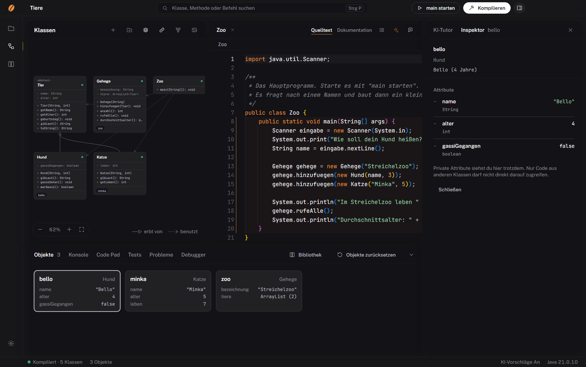</p>

<table>
<tr>
<td width="50%">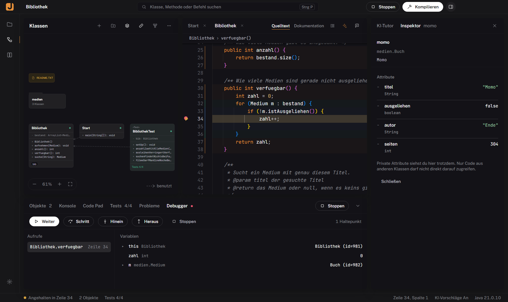<br><sub>Debugger: Haltepunkte, Schritt für Schritt, alle Variablen</sub></td>
<td width="50%">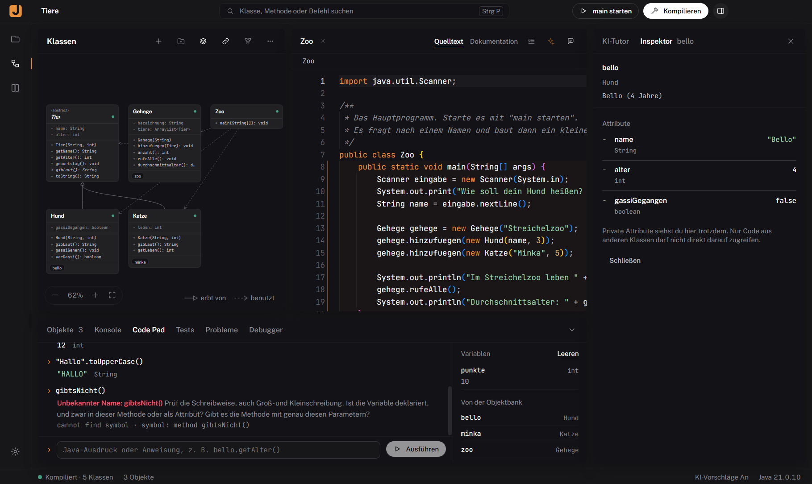<br><sub>Code Pad: Java eintippen, Wert sehen, Fehler erklärt</sub></td>
</tr>
<tr>
<td>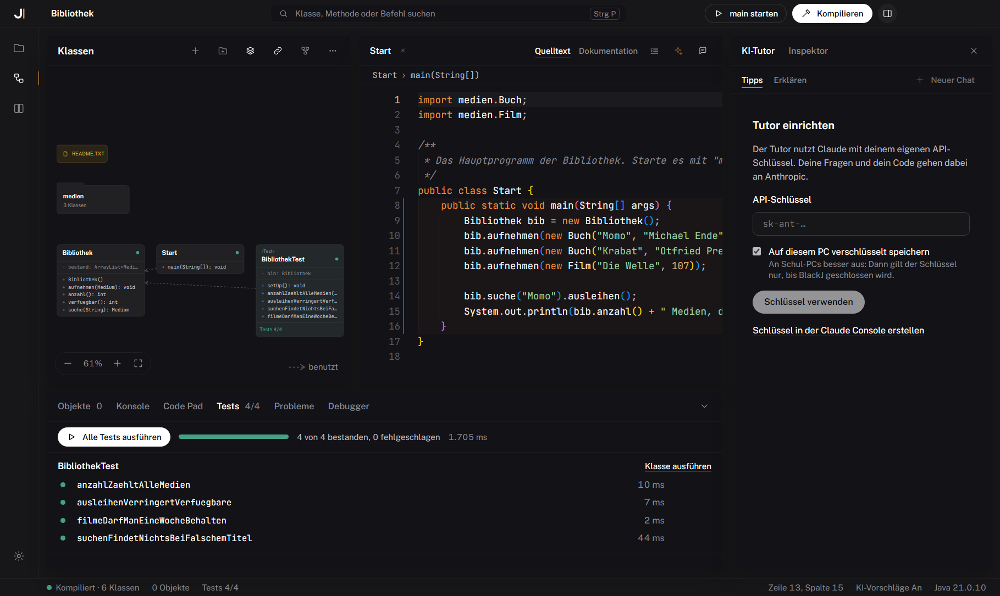<br><sub>JUnit 4 und 5, Testmethoden aufzeichnen</sub></td>
<td>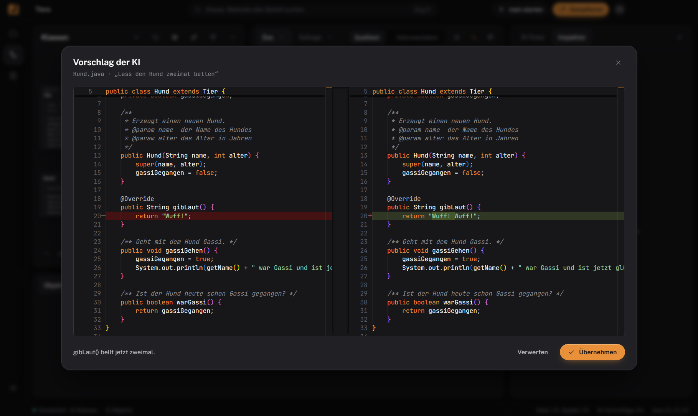<br><sub>KI schlägt vor, du entscheidest (Vergleich vor dem Übernehmen)</sub></td>
</tr>
<tr>
<td>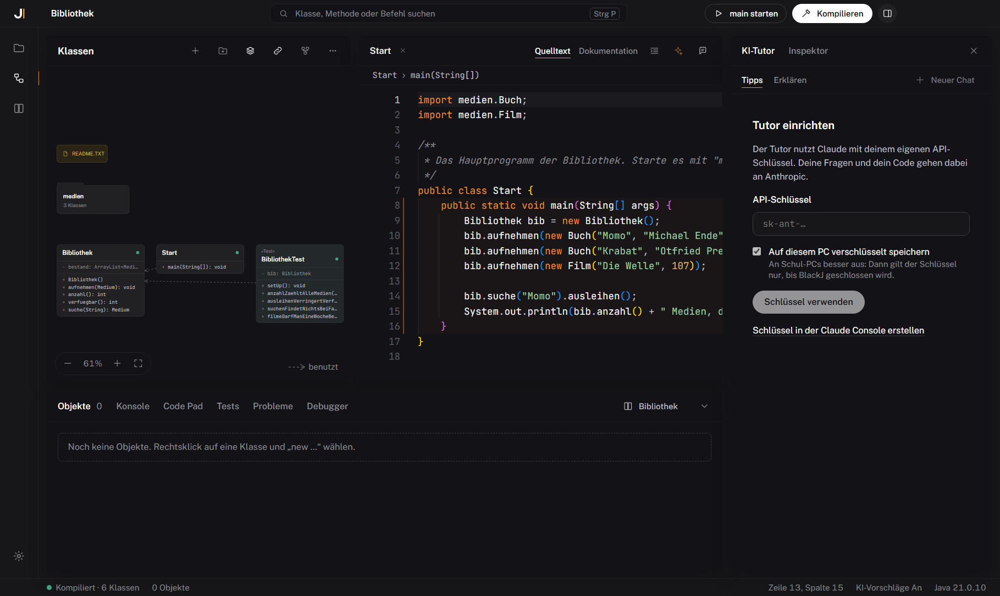<br><sub>Pakete wie in BlueJ</sub></td>
<td>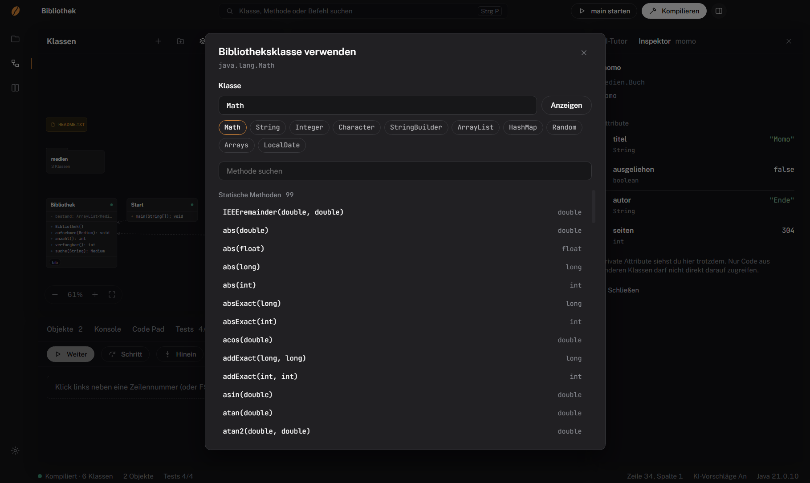<br><sub>Bibliotheksklassen wie Math oder ArrayList ausprobieren</sub></td>
</tr>
<tr>
<td>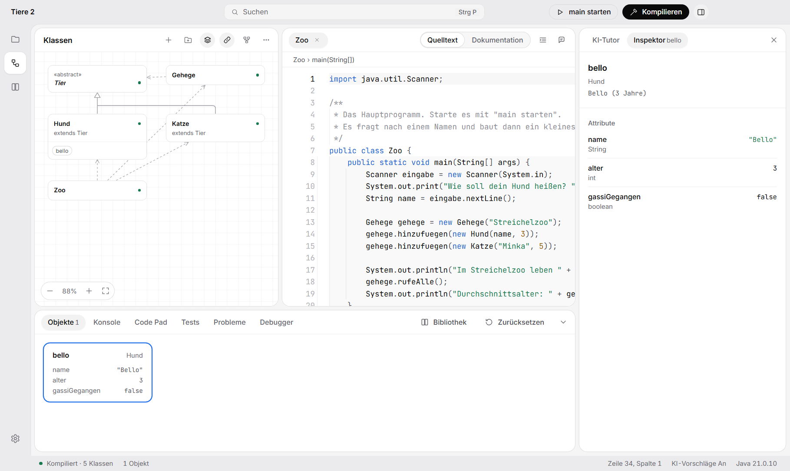<br><sub>Helles und dunkles Design</sub></td>
<td>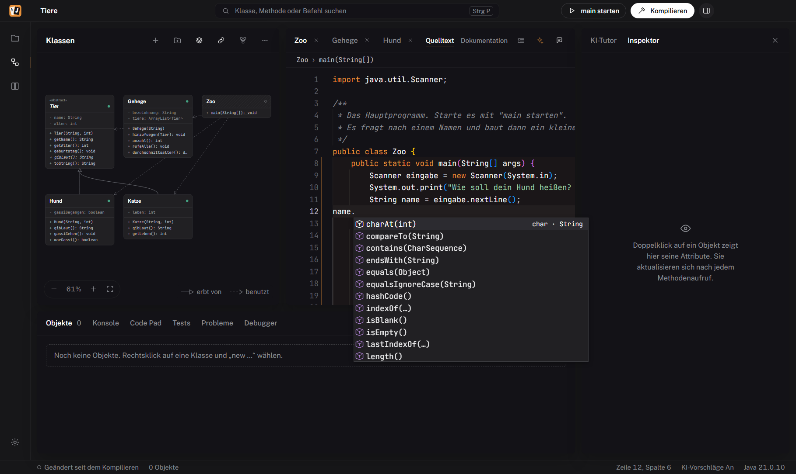<br><sub>Vervollständigung passend zum Typ, auch für String, Scanner, ArrayList</sub></td>
</tr>
<tr>
<td>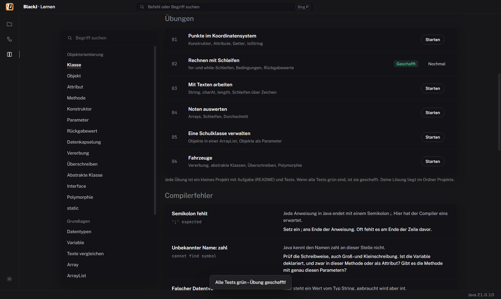<br><sub>Übungen mit Tests: alle grün heißt geschafft</sub></td>
<td>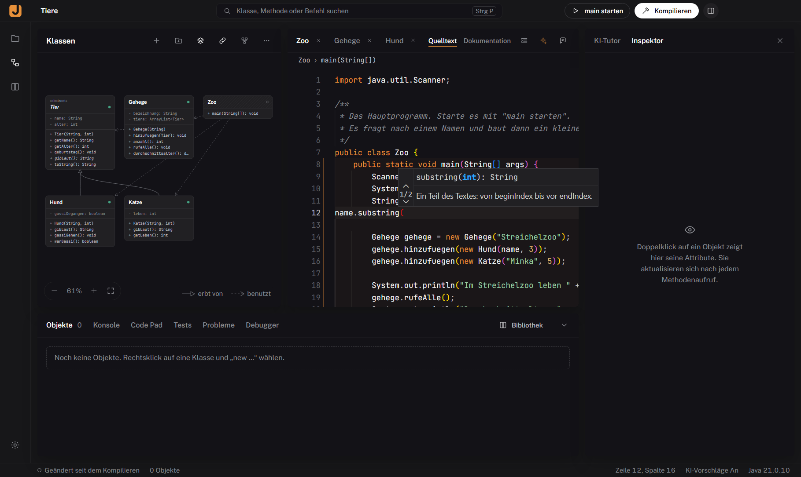<br><sub>Parameter-Hinweise mit Erklärung beim Tippen</sub></td>
</tr>
<tr>
<td>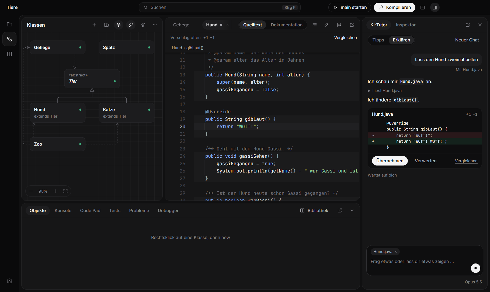<br><sub>Der Tutor liest deinen Code und schlägt Änderungen vor</sub></td>
<td>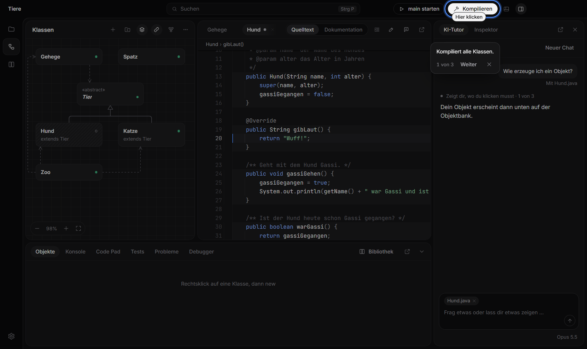<br><sub>Tutorials zeigen dir, wo du klicken musst</sub></td>
</tr>
<tr>
<td>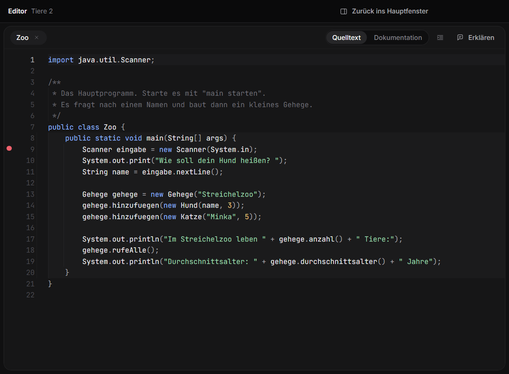<br><sub>Editor, Leiste und Seitenpanel als eigenes Fenster</sub></td>
<td></td>
</tr>
</table>

---

## Was BlackJ kann

**Wie BlueJ**
- Klassendiagramm mit Vererbung (`extends`, `implements`) und Benutzt-Pfeilen, Pakete als Ordner zum Hineinklicken, README-Notiz
- Objekte erzeugen (Rechtsklick → `new …`), Methoden aufrufen, Rückgabewerte ansehen, Objekte als Parameter übergeben
- Objekte inspizieren, auch private und geerbte Attribute, Klassenvariablen (static)
- Bibliotheksklassen verwenden: `Math`, `String`, `ArrayList`, `Random` … direkt ausprobieren, Methoden als durchsuchbare Liste statt endlosem Menü
- Code Pad: Java eintippen, Wert sehen, Variablen bleiben erhalten
- Konsole mit Eingabe (`Scanner`), `main` starten, Programm stoppen
- Debugger: Haltepunkte, Schritt / Hinein / Heraus, Aufrufstapel und Variablen
- JUnit 4 und 5: Tests ausführen, Ergebnis je Test, **Testmethode aufzeichnen** wie in BlueJ, Testfixture von der Objektbank speichern und wieder auf die Objektbank holen
- Vererbungspfeile im Diagramm ziehen (schreibt `extends` / `implements`) und wieder entfernen
- `main` mit Argumenten starten, laufendes Programm im Debugger anhalten
- Quelltext und Klassendiagramm drucken, Konsole als Textdatei speichern
- Kein Java auf dem PC? „Java einrichten“ lädt Eclipse Temurin 21 (das JDK, das auch BlueJ mitbringt)
- Quelltext / Dokumentation umschalten (aus den Javadoc-Kommentaren), farbige Blöcke (Scope-Highlighting)
- Als JAR exportieren, Projekte als **ZIP öffnen und als ZIP abgeben** (ohne `.class`-Dateien), Projekt speichern unter
- Projektdokumentation mit Javadoc erzeugen, Klasse aus Datei hinzufügen (die `package`-Zeile wird angepasst)
- **BlueJ-Projekte öffnen sich direkt** – inklusive Paketen, `+libs`-Bibliotheken und Positionen aus `package.bluej`. BlackJ verändert die `package.bluej`-Dateien nicht.

**Und mehr**
- Moderner Editor (Monaco, der Editor aus VS Code) mit Snippets (`sout`, `fori`, `get`, `set`, `test`) und Erklärungen beim Überfahren von Schlüsselwörtern
- Autovervollständigung nach dem Punkt, passend zum Typ: eigene Klassen, aber auch `String`, `ArrayList<Tier>`, `Scanner`, `Math`, `System.out` – die wichtigsten Methoden mit kurzer Erklärung auf Deutsch
- Jeder Compilerfehler und jede Exception wird auf Deutsch erklärt, mit Tipp zur Lösung
- Live-Inspektor neben dem Code, Objektkarten zeigen ihre Attributwerte
- Klassendiagramm als PNG speichern, zum Beispiel für den Projektbericht
- Befehlspalette (`Strg+P`) für Klassen, Methoden, Befehle und Lernbegriffe, Tastenkürzel-Übersicht mit `F1`
- Passt sich kleinen Schulbildschirmen an (1280×720), Projekte per Drag & Drop öffnen, Änderungen von außen werden übernommen
- Panels frei anordnen: Trennlinien ziehen, Panels an ihrem Kopf verschieben, Editor, untere Leiste oder Seitenpanel in ein eigenes Fenster holen
- Lernen-Seite mit den wichtigsten OOP-Begriffen, Beispielen und Suche
- **6 Übungen mit Tests**: Konstruktor, Schleifen, Texte, Arrays, ArrayList, Vererbung. Aufgabe lesen, Code schreiben, Tests laufen lassen – alle grün heißt geschafft
- Dunkles und helles Design, Deutsch und Englisch

**KI (optional, mit eigenem API-Schlüssel)**
- KI-Tutor im Modus *Tipps* (hilft dir, selbst auf die Lösung zu kommen) oder *Erklären*
- Der Tutor arbeitet wie ein Agent: Er sieht dein Projekt, liest Dateien, kompiliert, führt Tests aus und schlägt Änderungen als Vergleich vor (oder schreibt sie selbst, wenn du das erlaubst)
- Tutorials direkt in BlackJ: Der Tutor zieht einen Ring um den Knopf, den du drücken musst („Hier klicken“)
- Modus *Bauen*: Beschreib ein Programm („Snake“, „Minecraft-artig“), und der Tutor plant, schreibt alle Klassen, kompiliert und behebt Fehler ohne Rückfragen. Danach: Starten oder alles rückgängig machen
- KI-Vorschläge beim Tippen (grauer Text, `Tab` übernimmt)
- `Strg+I`: „Mit KI schreiben“ – Änderung erscheint als Vergleich, du entscheidest
- „Mit KI beheben“ bei Compilerfehlern
- Ein Schalter blendet alle KI-Funktionen aus, zum Beispiel für Klassenarbeiten
- Der Schlüssel bleibt auf deinem PC (verschlüsselt oder nur für die Sitzung). Fragen und Code gehen an Anthropic.

## Benutzen

1. [`BlackJ.exe` herunterladen](../../releases/latest) und starten. Windows fragt beim ersten Start evtl. nach („Unbekannter Herausgeber“ → *Weitere Informationen* → *Trotzdem ausführen*), weil die Datei nicht signiert ist.
2. Java: BlackJ findet ein installiertes JDK ab Version 11 automatisch, auch das von BlueJ. Für den USB-Stick einen Ordner `jdk` neben `BlackJ.exe` legen (zum Beispiel den `jdk`-Ordner aus einer BlueJ-Installation).
3. Einstellungen und Projekte liegen neben der App (`BlackJ-Daten`, `Projekte`), nicht auf C:.

| Taste | Aktion |
| --- | --- |
| `Strg+K` | Kompilieren |
| `F5` | `main` starten |
| `Strg+P` | Suchen / Befehle |
| `Strg+N` | Neue Klasse |
| `Strg+I` | Mit KI schreiben |
| `F9` | Haltepunkt |
| `F8` / `F10` / `F11` | Weiter / Schritt / Hinein |
| `Strg+S` | Speichern |
| `Strg+Umschalt+L` | KI-Tutor / Inspektor ein-aus |
| `F1` | Alle Tastenkürzel |

## Selbst bauen

Voraussetzungen: Node.js 22, ein JDK ab 11.

```
npm install
npm run fetch:junit   # lädt die JUnit-Jars von Maven Central
npm start             # baut alles und startet BlackJ
npm test              # Compiler, Objektbank, Code Pad, KI, JUnit, Debugger, ZIP, Übungen
npm run dist          # baut BlackJ.exe (portable)
```

`electron . --smoke=<ordner>` fährt einen kompletten Testlauf durch die echte App und speichert Screenshots.

**Release:** Version in `package.json` erhöhen, Release-Text nach `docs/releases/v<version>.md` schreiben, Tag `v<version>` pushen oder unter Actions → Release → *Run workflow* starten. GitHub baut `BlackJ.exe` und veröffentlicht das Release.

**Aufbau:** `electron/` (Fenster, Projekte, javac, Objektbank, Debugger, JUnit, KI) · `java/` (läuft in einer eigenen JVM: Objektbank und Code Pad per Reflection, Debugger per JDI) · `src/` (Oberfläche, React + Monaco) · `resources/examples` (Beispielprojekte).

BlackJ zeichnet ohne Grafikkarte, und Programme der Schüler laufen mit abgeschaltetem Direct3D – das schützt vor abstürzenden Grafiktreibern.

---

### English

BlackJ is a BlueJ-style Java IDE for school: class diagram, interactive object bench (also for library classes such as `Math` or `ArrayList`), code pad, debugger, JUnit with test recording, ZIP import and export, plain-language error explanations, and an optional AI tutor that uses your own Claude API key. It opens BlueJ projects as they are. Download `BlackJ.exe` from the [latest release](../../releases/latest); the interface is available in German and English.

BlackJ is an independent project and not affiliated with the BlueJ team. [MIT License](LICENSE). JUnit jars are redistributed under their own licences (see `resources/junit/LICENSES.txt`).
